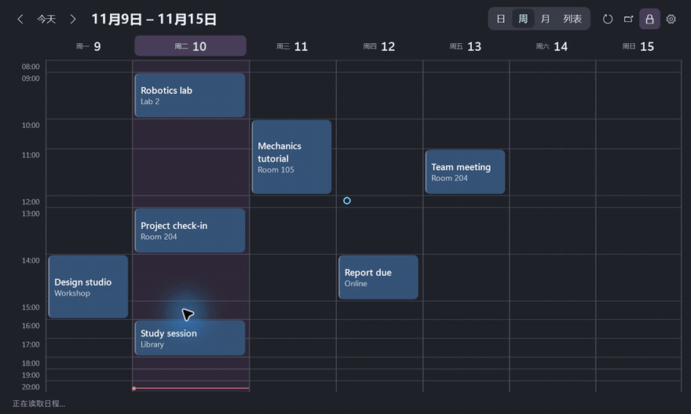

# Desktop Agenda · 桌面日历

**简体中文** · [English](https://github.com/chenbinghan666/desktop-agenda/blob/main/docs/locales/README.en.md) · [日本語](https://github.com/chenbinghan666/desktop-agenda/blob/main/docs/locales/README.ja.md) · [Deutsch](https://github.com/chenbinghan666/desktop-agenda/blob/main/docs/locales/README.de.md) · [Français](https://github.com/chenbinghan666/desktop-agenda/blob/main/docs/locales/README.fr.md) · [Español](https://github.com/chenbinghan666/desktop-agenda/blob/main/docs/locales/README.es.md) · [Português](https://github.com/chenbinghan666/desktop-agenda/blob/main/docs/locales/README.pt.md)

把 Google 日历放在 Windows 桌面上。日、周、月和列表四种视图方便随时查看课表、会议和截止日期。日程通过 iCal 只读同步。

C# · WPF · Google Calendar · [下载桌面日历](https://github.com/chenbinghan666/desktop-agenda/releases/latest)


<table>
  <tr>
    <td width="50%"><br>浅色周视图</td>
    <td width="50%"><br>浅色月视图</td>
  </tr>
</table>

截图均使用虚构日程。

## 功能

| 功能 | 操作与效果 |
| --- | --- |
| **日、周、月、列表** | 从顶部切换视图。日、周视图默认一屏显示，并把更多高度分给标题较长的时段。月视图可点日期展开，列表按天显示未来 30 天的日程。 |
| **桌面固定** | 拖动顶部日期移动，拖边缘调整大小。点锁形图标固定位置和大小，再点一次解锁。位置、大小和锁定状态会保存。 |
| **日程详情** | 卡片显示标题和地点。悬停约 250 毫秒查看完整标题、时间和地点，单击可查看备注。 |
| **个性化** | 跟随 Windows 应用颜色模式，支持简体中文和 English。可调整卡片颜色、字号、不透明度、时间范围和一周起始日。 |
| **自动同步** | 挂件运行时每 5 分钟尝试刷新，也可手动刷新。同步失败时保留上次成功读取的日程。 |

## 实操演示

[](docs/images/desktop-agenda-demo.mp4)

[下载 MP4](docs/images/desktop-agenda-demo.mp4?raw=true)

## 安装和连接

需要 **Windows 11 x64** 和 [.NET 10 Desktop Runtime（x64）](https://dotnet.microsoft.com/download/dotnet/10.0)。

1. 从 [Releases](https://github.com/chenbinghan666/desktop-agenda/releases/latest) 下载 Windows 压缩包，解压后双击 `DesktopAgenda.exe`。
2. 在 [Google 日历网页版设置](https://calendar.google.com/calendar/u/0/r/settings) 中，进入 **我的日历设置 → 选中一本日历 → 集成日历**。
3. 复制 **以 iCal 格式显示的非公开网址**，在挂件中打开 **齿轮 → 订阅**，粘贴地址并保存。

一次可连接一本日历。订阅地址、日程缓存和界面设置保存在本机的 `%LOCALAPPDATA%\DesktopAgenda`。如果工作或学校账号没有显示非公开网址，可能是管理员限制了 iCal 订阅。 [Google 日历 iCal 帮助](https://support.google.com/calendar/answer/37648?hl=zh-Hans)

需要随登录启动时，在 Windows 运行框输入 `shell:startup`，把程序的**快捷方式**放进打开的文件夹。

## 从源码构建

使用 Windows 上的 **.NET 10 SDK**。界面使用 WPF，设置窗口使用 WinForms，iCal 解析使用 Ical.Net。

```powershell
dotnet publish .\src\DesktopAgenda\DesktopAgenda.csproj -c Release -r win-x64 -p:SelfContained=false -p:PublishSelfContained=false -p:PublishSingleFile=true -o .\dist
```

`dist\DesktopAgenda.exe` 可直接运行。依赖许可见 [第三方许可](third-party/README.md)。
