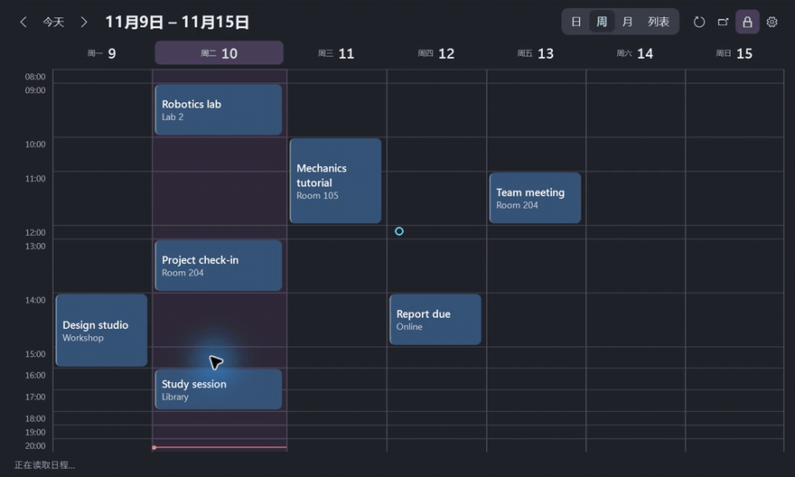

# Desktop Agenda

[简体中文](https://github.com/chenbinghan666/desktop-agenda/blob/main/README.md) · [English](https://github.com/chenbinghan666/desktop-agenda/blob/main/docs/locales/README.en.md) · [日本語](https://github.com/chenbinghan666/desktop-agenda/blob/main/docs/locales/README.ja.md) · **Deutsch** · [Français](https://github.com/chenbinghan666/desktop-agenda/blob/main/docs/locales/README.fr.md) · [Español](https://github.com/chenbinghan666/desktop-agenda/blob/main/docs/locales/README.es.md) · [Português](https://github.com/chenbinghan666/desktop-agenda/blob/main/docs/locales/README.pt.md)

Zeigt Google Kalender direkt auf dem Windows-Desktop an. Tages-, Wochen-, Monats- und Listenansicht helfen dabei, Kurse, Termine und Fristen im Blick zu behalten. Die Synchronisierung über iCal ist schreibgeschützt.

C# · WPF · Google Kalender · [Desktop-Kalender](https://github.com/chenbinghan666/desktop-agenda/releases/latest) herunterladen

## Demo

[](../../docs/images/desktop-agenda-demo.mp4)

[MP4 herunterladen](../../docs/images/desktop-agenda-demo.mp4?raw=true)


<table>
  <tr>
    <td width="50%"><br>Helle Wochenansicht</td>
    <td width="50%"><br>Helle Mondansicht</td>
  </tr>
</table>

Die Screenshots verwenden alle einen fiktiven Zeitplan.

## Funktion

| Funktion | Wirkungsweise und Wirkung |
| --- | --- |
| **Tag, Woche, Monat, Liste** | Ansicht von oben wechseln. Die Tages- und Wochenansichten werden standardmäßig auf einem Bildschirm angezeigt, und Zeiträumen mit längeren Titeln wird mehr Höhe zugewiesen. Die Monatsansicht kann durch Klicken auf das Datum erweitert werden und die Liste zeigt den Zeitplan für die nächsten 30 Tage tageweise an. |
| **Desktop behoben** | Ziehen Sie das obere Datum, um es zu verschieben, und ziehen Sie an den Rändern, um die Größe zu ändern. Klicken Sie auf das Schlosssymbol, um die Position und Größe festzulegen, und klicken Sie erneut, um die Sperre aufzuheben. Position, Größe und Sperrstatus werden gespeichert. |
| **Zeitplandetails** | Auf der Karte werden Titel und Ort angezeigt. Bewegen Sie den Mauszeiger etwa 250 Millisekunden lang, um den vollständigen Titel, die Zeit und den Ort anzuzeigen. Klicken Sie, um Notizen anzuzeigen. |
| **Personalisierung** | Befolgen Sie den Farbmodus der Windows-Anwendung und unterstützen Sie vereinfachtes Chinesisch und Englisch. Kartenfarbe, Schriftgröße, Deckkraft, Zeitbereich und Wochenbeginn können angepasst werden. |
| **synchronisiert sich automatisch mit** | Das Widget versucht, alle 5 Minuten zu aktualisieren, wenn es ausgeführt wird, oder es kann manuell aktualisiert werden. Wenn die Synchronisierung fehlschlägt, wird der letzte erfolgreich gelesene Zeitplan beibehalten. |

## Installation und Anschluss

Erfordert **Windows 11 x64** und [.NET 10 Desktop Runtime (x64)](https://dotnet.microsoft.com/download/dotnet/10.0).

1. Laden Sie das komprimierte Windows-Paket von [Reases](https://github.com/chenbinghan666/desktop-agenda/releases/latest) herunter, entpacken Sie es und doppelklicken Sie auf `DesktopAgenda.exe`.
2. Geben Sie in den [Google Kalender-Webversionseinstellungen](https://calendar.google.com/calendar/u/0/r/settings) **Meine Kalendereinstellungen ein → Kalender auswählen → Integrierter Kalender**.
3. Kopieren Sie die von **angezeigte nicht öffentliche URL** im iCal-Format, öffnen Sie das **-Zahnrad im Widget → abonnieren Sie**, fügen Sie die Adresse ein und speichern Sie.

Es kann jeweils nur ein Kalender verbunden werden. Die Abonnementadresse, der Zeitplan-Cache und die Schnittstelleneinstellungen werden in `%LOCALAPPDATA%\DesktopAgenda` des lokalen Computers gespeichert. Wenn Ihr Geschäfts- oder Schulkonto keine nicht öffentliche URL anzeigt, hat Ihr Administrator möglicherweise iCal-Abonnements eingeschränkt. [Google Kalender iCal-Hilfe](https://support.google.com/calendar/answer/37648?hl=zh-Hans)

Wenn es mit der Anmeldung gestartet werden muss, geben Sie `shell:startup` in das Windows-Feld „Ausführen“ ein und legen Sie die **-Verknüpfung** des Programms im geöffneten Ordner ab.

## Aus dem Quellcode erstellen

Verwendung von **.NET 10 SDK** unter Windows. Die Schnittstelle verwendet WPF, das Einstellungsfenster verwendet WinForms und die iCal-Analyse verwendet Ical.Net.

```powershell
dotnet publish .\src\DesktopAgenda\DesktopAgenda.csproj -c Release -r win-x64 -p:SelfContained=false -p:PublishSelfContained=false -p:PublishSingleFile=true -o .\dist
```

`dist\DesktopAgenda.exe` kann direkt ausgeführt werden. Informationen zu abhängigen Lizenzen finden Sie unter [Third Party License](../../third-party/README.md).
