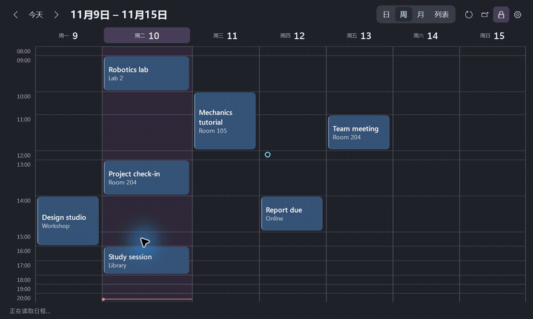

# Desktop Agenda

[简体中文](https://github.com/chenbinghan666/desktop-agenda/blob/main/README.md) · [English](https://github.com/chenbinghan666/desktop-agenda/blob/main/docs/locales/README.en.md) · [日本語](https://github.com/chenbinghan666/desktop-agenda/blob/main/docs/locales/README.ja.md) · [Deutsch](https://github.com/chenbinghan666/desktop-agenda/blob/main/docs/locales/README.de.md) · [Français](https://github.com/chenbinghan666/desktop-agenda/blob/main/docs/locales/README.fr.md) · **Español** · [Português](https://github.com/chenbinghan666/desktop-agenda/blob/main/docs/locales/README.pt.md)

Muestra Google Calendar en el escritorio de Windows. Las vistas de día, semana, mes y lista permiten consultar clases, reuniones y plazos. La sincronización mediante iCal es de solo lectura.

C# · WPF · Google Calendar · [Descargar calendario de escritorio](https://github.com/chenbinghan666/desktop-agenda/releases/latest)

Vista de la semana oscura 

<table>
  <tr>
    <td width="50%"><br>Vista de semana ligera</td>
    <td width="50%"><br>Vista de luna clara</td>
  </tr>
</table>

Todas las capturas de pantalla utilizan un horario ficticio.

## Función

| Función | Operación y efecto |
| --- | --- |
| **día, semana, mes, lista** | Cambiar vista desde arriba. Las vistas de día y semana se muestran en una pantalla de forma predeterminada y se asigna más altura a los períodos con títulos más largos. La vista mensual se puede ampliar haciendo clic en la fecha y la lista muestra el calendario de los próximos 30 días por día. |
| **Escritorio fijo** | Arrastra la fecha superior para moverla y arrastra los bordes para cambiar su tamaño. Haga clic en el icono de candado para fijar la posición y el tamaño, y haga clic nuevamente para desbloquear. Se guardan la posición, el tamaño y el estado de bloqueo. |
| Detalles del horario de **** | La tarjeta muestra el título y la ubicación. Pase el cursor durante aproximadamente 250 milisegundos para ver el título completo, la hora y la ubicación; haga clic para ver las notas. |
| **Personalización** | Siga el modo de color de la aplicación de Windows, admite chino simplificado e inglés. Se puede ajustar el color de la tarjeta, el tamaño de fuente, la opacidad, el rango de tiempo y el inicio de la semana. |
| **se sincroniza automáticamente con** | El widget intentará actualizarse cada 5 minutos cuando se esté ejecutando, o puede actualizarse manualmente. Cuando falla la sincronización, se conserva la última programación leída correctamente. |

## Demostración

[](../../docs/images/desktop-agenda-demo.mp4)

[Descargar MP4](../../docs/images/desktop-agenda-demo.mp4?raw=true)

## Instalación y conexión

Requiere **Windows 11 x64** y [.NET 10 Desktop Runtime (x64)](https://dotnet.microsoft.com/download/dotnet/10.0).

1. Descargue el paquete comprimido de Windows desde [Releases](https://github.com/chenbinghan666/desktop-agenda/releases/latest), descomprímalo y haga doble clic en `DesktopAgenda.exe`.
2. En [Configuración de la versión web de Google Calendar](https://calendar.google.com/calendar/u/0/r/settings), ingrese **configuración de mi calendario → seleccione un calendario → calendario integrado**.
3. Copie la URL privada **mostrada por** en formato iCal, abra el engranaje **en el widget → suscríbase a**, pegue la dirección y guarde.

Se puede conectar un calendario a la vez. La dirección de suscripción, la caché de programación y la configuración de la interfaz se guardan en `%LOCALAPPDATA%\DesktopAgenda` de la máquina local. Si su cuenta profesional o educativa no muestra una URL no pública, es posible que su administrador haya restringido las suscripciones de iCal. [Ayuda de Google Calendar iCal](https://support.google.com/calendar/answer/37648?hl=zh-Hans)

Cuando sea necesario iniciar sesión, ingrese `shell:startup` en el cuadro Ejecutar de Windows y coloque el acceso directo **** del programa en la carpeta abierta.

## Construir desde la fuente

Usando **.NET 10 SDK** en Windows. La interfaz usa WPF, la ventana de configuración usa WinForms y el análisis de iCal usa Ical.Net.

```powershell
dotnet publish .\src\DesktopAgenda\DesktopAgenda.csproj -c Release -r win-x64 -p:SelfContained=false -p:PublishSelfContained=false -p:PublishSingleFile=true -o .\dist
```

`dist\DesktopAgenda.exe` se puede ejecutar directamente. Para licencias dependientes, consulte Licencia de terceros [](../../third-party/README.md).
