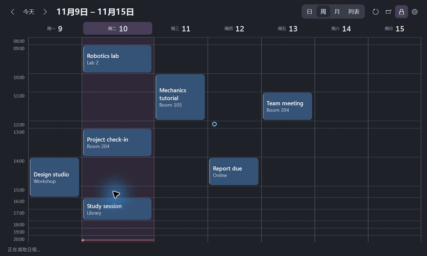

# Desktop Agenda

[简体中文](https://github.com/chenbinghan666/desktop-agenda/blob/main/README.md) · [English](https://github.com/chenbinghan666/desktop-agenda/blob/main/docs/locales/README.en.md) · [日本語](https://github.com/chenbinghan666/desktop-agenda/blob/main/docs/locales/README.ja.md) · [Deutsch](https://github.com/chenbinghan666/desktop-agenda/blob/main/docs/locales/README.de.md) · **Français** · [Español](https://github.com/chenbinghan666/desktop-agenda/blob/main/docs/locales/README.es.md) · [Português](https://github.com/chenbinghan666/desktop-agenda/blob/main/docs/locales/README.pt.md)

Affiche Google Agenda sur le bureau Windows. Les vues jour, semaine, mois et liste facilitent le suivi des cours, réunions et échéances. La synchronisation via iCal se fait en lecture seule.

C# · WPF · Google Calendar · [Télécharger le calendrier de bureau](https://github.com/chenbinghan666/desktop-agenda/releases/latest)

Vue de la semaine sombre 

<table>
  <tr>
    <td width="50%"><br>Vue semaine-lumière</td>
    <td width="50%"><br>Vue de la lune claire</td>
  </tr>
</table>

Les captures d'écran utilisent toutes un horaire fictif.

## Fonction

| Fonction | Fonctionnement et effet |
| --- | --- |
| **jour, semaine, mois, liste** | Changer la vue du haut. Les vues quotidiennes et hebdomadaires sont affichées sur un seul écran par défaut, et plus de hauteur est allouée aux périodes avec des titres plus longs. La vue mensuelle peut être développée en cliquant sur la date, et la liste affiche le calendrier des 30 prochains jours par jour. |
| **Bureau fixe** | Faites glisser la date supérieure pour la déplacer et faites glisser les bords pour la redimensionner. Cliquez sur l'icône de verrouillage pour fixer la position et la taille, puis cliquez à nouveau pour déverrouiller. La position, la taille et l'état du verrouillage sont enregistrés. |
| Détails du calendrier **** | La carte affiche le titre et l'emplacement. Passez la souris pendant environ 250 millisecondes pour voir le titre complet, l'heure et le lieu, cliquez pour afficher les notes. |
| **Personnalisation** | Suivez le mode couleur de l'application Windows, prenez en charge le chinois simplifié et l'anglais. La couleur de la carte, la taille de la police, l’opacité, la plage horaire et le début de la semaine peuvent être ajustés. |
| **se synchronise automatiquement avec** | Le widget tentera de s'actualiser toutes les 5 minutes lorsqu'il est en cours d'exécution, ou il peut être actualisé manuellement. Lorsque la synchronisation échoue, la dernière programmation lue avec succès est conservée. |

## Démonstration

[](../../docs/images/desktop-agenda-demo.mp4)

[Télécharger le MP4](../../docs/images/desktop-agenda-demo.mp4?raw=true)

## Installation et connexion

Nécessite **Windows 11 x64** et [.NET 10 Desktop Runtime (x64)](https://dotnet.microsoft.com/download/dotnet/10.0).

1. Téléchargez le package compressé Windows à partir de [Releases](https://github.com/chenbinghan666/desktop-agenda/releases/latest), décompressez-le et double-cliquez sur `DesktopAgenda.exe`.
2. Dans [Paramètres de la version Web de Google Calendar](https://calendar.google.com/calendar/u/0/r/settings), entrez **mes paramètres de calendrier → sélectionnez un calendrier → calendrier intégré**.
3. Copiez l'URL non publique **affichée par** au format iCal, ouvrez l'engrenage **dans le widget → abonnez-vous à**, collez l'adresse et enregistrez.

Un calendrier peut être connecté à la fois. L'adresse d'abonnement, le cache de planification et les paramètres d'interface sont enregistrés dans `%LOCALAPPDATA%\DesktopAgenda` de la machine locale. Si votre compte professionnel ou scolaire n'affiche pas d'URL non publique, votre administrateur a peut-être restreint les abonnements iCal. [Aide iCal Google Agenda](https://support.google.com/calendar/answer/37648?hl=zh-Hans)

Lorsqu'il doit être démarré avec connexion, entrez `shell:startup` dans la zone Exécuter de Windows et placez le raccourci **** du programme dans le dossier ouvert.

## Construire à partir des sources

Utilisation de **.NET 10 SDK** sous Windows. L'interface utilise WPF, la fenêtre des paramètres utilise WinForms et l'analyse iCal utilise Ical.Net.

```powershell
dotnet publish .\src\DesktopAgenda\DesktopAgenda.csproj -c Release -r win-x64 -p:SelfContained=false -p:PublishSelfContained=false -p:PublishSingleFile=true -o .\dist
```

`dist\DesktopAgenda.exe` peut être exécuté directement. Pour les licences dépendantes, voir Licence tierce [](../../third-party/README.md).
