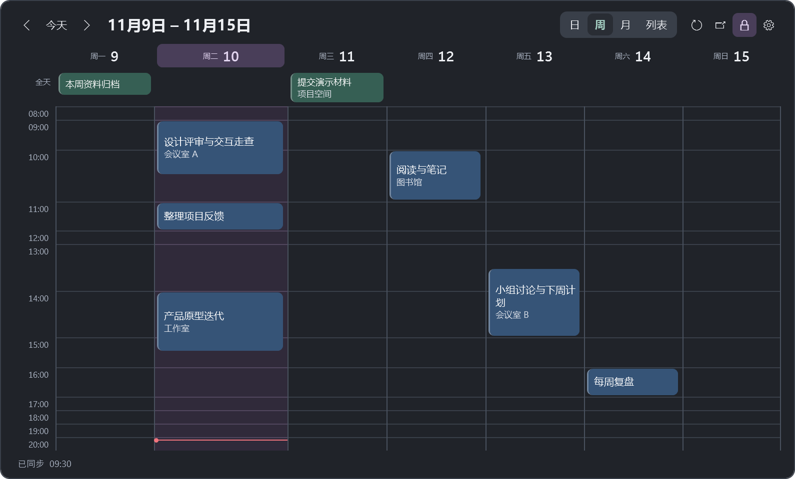
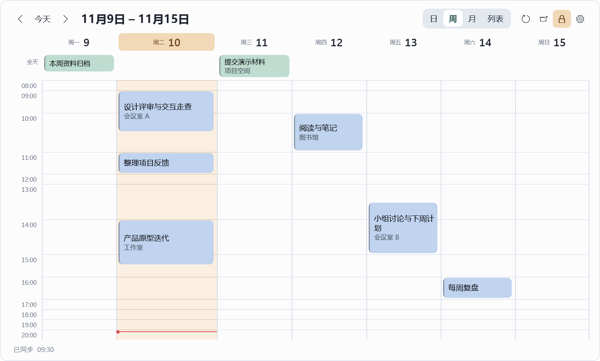
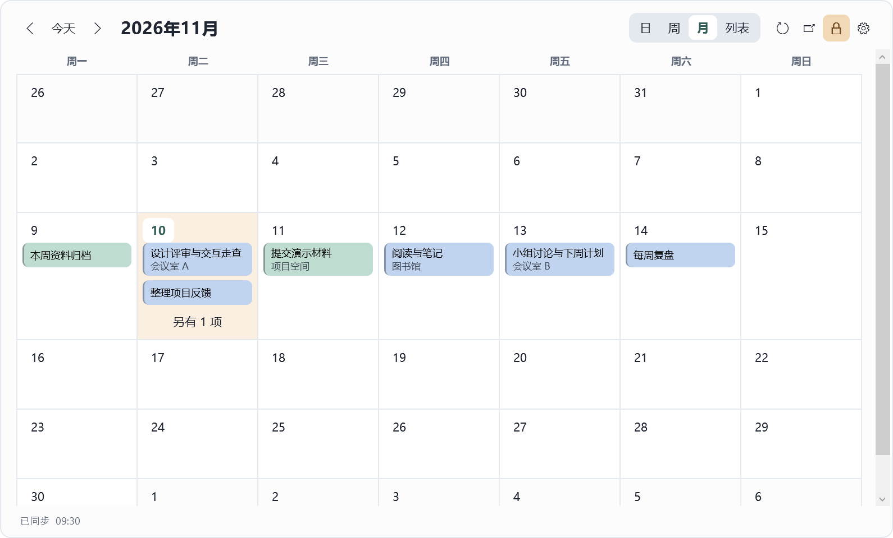

# Desktop Agenda

[简体中文](https://github.com/chenbinghan666/desktop-agenda/blob/main/README.md) · [English](https://github.com/chenbinghan666/desktop-agenda/blob/main/docs/locales/README.en.md) · **日本語** · [Deutsch](https://github.com/chenbinghan666/desktop-agenda/blob/main/docs/locales/README.de.md) · [Français](https://github.com/chenbinghan666/desktop-agenda/blob/main/docs/locales/README.fr.md) · [Español](https://github.com/chenbinghan666/desktop-agenda/blob/main/docs/locales/README.es.md) · [Português](https://github.com/chenbinghan666/desktop-agenda/blob/main/docs/locales/README.pt.md)

Google カレンダーを Windows のデスクトップに表示します。日・週・月・一覧の表示を切り替えて、授業や会議、締め切りを確認できます。iCal による読み取り専用の同期に対応しています。

C# ・ WPF ・ Google カレンダー ・ [デスクトップカレンダーをダウンロード](https://github.com/chenbinghan666/desktop-agenda/releases/latest)



<table>
  <tr>
    <td width="50%"><br>ライトウィークビュー</td>
    <td width="50%"><br>明るい月の眺め</td>
  </tr>
</table>

スクリーンショットはすべて架空のスケジュールを使用しています。

## 機能

| 機能 | 作用と効果 |
| --- | --- |
| **日、週、月、リスト** | 上からのビューを切り替えます。日ビューと週ビューはデフォルトで 1 つの画面に表示され、タイトルが長い期間にはより多くの高さが割り当てられます。日付をクリックすると月ビューが展開され、リストには今後 30 日間のスケジュールが日ごとに表示されます。 |
| **デスクトップ固定** | 上部の日付をドラッグして移動し、端をドラッグしてサイズを変更します。鍵のアイコンをクリックして位置とサイズを固定し、もう一度クリックしてロックを解除します。位置、サイズ、ロック状態が保存されます。 |
| **スケジュール詳細** | カードにはタイトルと場所が表示されます。約 250 ミリ秒間マウスを移動すると、完全なタイトル、時間、場所が表示され、クリックするとメモが表示されます。 |
| **カスタマイズ** | Windows アプリケーションのカラー モードに従い、簡体字中国語と英語をサポートします。カードの色、フォント サイズ、不透明度、時間範囲、週の始まりを調整できます。 |
| **は** と自動的に同期します | ウィジェットは、実行中は 5 分ごとに更新を試みますが、手動で更新することもできます。同期が失敗した場合、最後に正常に読み取られたスケジュールが保持されます。 |

## 設置と接続

**Windows 11 x64** および [.NET 10 デスクトップ ランタイム (x64)](https://dotnet.microsoft.com/download/dotnet/10.0) が必要です。

1. [Releases](https://github.com/chenbinghan666/desktop-agenda/releases/latest) から Windows 圧縮パッケージをダウンロードし、解凍して `DesktopAgenda.exe` をダブルクリックします。
2. [Googleカレンダーウェブ版設定](https://calendar.google.com/calendar/u/0/r/settings)で、**マイカレンダー設定→カレンダーを選択→統合カレンダー**と入力します。
3. **で表示された非公開URL**をiCal形式でコピーし、ウィジェットで**ギアを開き→**を購読し、アドレスを貼り付けて保存します。

一度に接続できるカレンダーは 1 つです。サブスクリプション アドレス、スケジュール キャッシュ、インターフェイス設定は、ローカル マシンの `%LOCALAPPDATA%\DesktopAgenda` に保存されます。職場または学校のアカウントに非公開 URL が表示されない場合は、管理者が iCal サブスクリプションを制限している可能性があります。 [Google カレンダー iCal ヘルプ](https://support.google.com/calendar/answer/37648?hl=zh-Hans)

ログインして起動する必要がある場合は、Windows の [ファイル名を指定して実行] ボックスに「`shell:startup`」と入力し、開いているフォルダーにプログラムの **ショートカット** を置きます。

## ソースからビルドする

Windows で **.NET 10 SDK** を使用します。インターフェイスは WPF を使用し、設定ウィンドウは WinForms を使用し、iCal 解析は Ical.Net を使用します。

```powershell
dotnet publish .\src\DesktopAgenda\DesktopAgenda.csproj -c Release -r win-x64 -p:SelfContained=false -p:PublishSelfContained=false -p:PublishSingleFile=true -o .\dist
```

`dist\DesktopAgenda.exe` は直接実行できます。依存ライセンスについては、「[サードパーティ ライセンス」「](../../third-party/README.md)」を参照してください。
