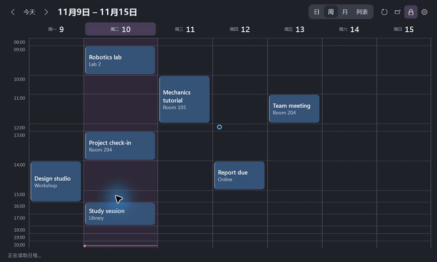

# Desktop Agenda

[简体中文](https://github.com/chenbinghan666/desktop-agenda/blob/main/README.md) · [English](https://github.com/chenbinghan666/desktop-agenda/blob/main/docs/locales/README.en.md) · [日本語](https://github.com/chenbinghan666/desktop-agenda/blob/main/docs/locales/README.ja.md) · [Deutsch](https://github.com/chenbinghan666/desktop-agenda/blob/main/docs/locales/README.de.md) · [Français](https://github.com/chenbinghan666/desktop-agenda/blob/main/docs/locales/README.fr.md) · [Español](https://github.com/chenbinghan666/desktop-agenda/blob/main/docs/locales/README.es.md) · **Português**

Mostra o Google Agenda na área de trabalho do Windows. As visualizações de dia, semana, mês e lista ajudam a acompanhar aulas, reuniões e prazos. A sincronização por iCal é somente leitura.

C# · WPF · Google Calendar · [Baixar calendário de desktop](https://github.com/chenbinghan666/desktop-agenda/releases/latest)

## Demonstração

[](../../docs/images/desktop-agenda-demo.mp4)

[Baixar MP4](../../docs/images/desktop-agenda-demo.mp4?raw=true)

Visualização da semana escura 

<table>
  <tr>
    <td width="50%"><br>Visualização da semana leve</td>
    <td width="50%"><br>Vista da lua clara</td>
  </tr>
</table>

Todas as capturas de tela usam uma programação fictícia.

## Função

| Função | Operação e efeito |
| --- | --- |
| **dia, semana, mês, lista** | Mude a visualização de cima. As visualizações de dia e semana são exibidas em uma tela por padrão, e mais altura é alocada para períodos com títulos mais longos. A visualização mensal pode ser ampliada clicando na data, e a lista exibe a programação dos próximos 30 dias por dia. |
| **Desktop fixo** | Arraste a data superior para movê-la e arraste as bordas para redimensioná-la. Clique no ícone de cadeado para corrigir a posição e o tamanho e clique novamente para desbloquear. A posição, o tamanho e o status do bloqueio são salvos. |
| Detalhes da programação **** | O cartão exibe o título e a localização. Passe o mouse por aproximadamente 250 milissegundos para ver o título completo, hora e local, clique para ver as notas. |
| **Personalização** | Siga o modo de cores do aplicativo Windows, suporte para chinês simplificado e inglês. A cor do cartão, o tamanho da fonte, a opacidade, o intervalo de tempo e o início da semana podem ser ajustados. |
| **sincroniza automaticamente com** | O widget tentará atualizar a cada 5 minutos quando estiver em execução ou poderá ser atualizado manualmente. Quando a sincronização falha, o último agendamento de leitura bem-sucedido é retido. |

## Instalação e conexão

Requer **Windows 11 x64** e [.NET 10 Desktop Runtime (x64)](https://dotnet.microsoft.com/download/dotnet/10.0).

1. Baixe o pacote compactado do Windows em [Releases](https://github.com/chenbinghan666/desktop-agenda/releases/latest), descompacte-o e clique duas vezes em `DesktopAgenda.exe`.
2. Nas configurações da versão web do Google Agenda [](https://calendar.google.com/calendar/u/0/r/settings), insira **minhas configurações de calendário → selecione um calendário → calendário integrado**.
3. Copie o URL não público **exibido por** no formato iCal, abra a engrenagem **no widget → inscreva-se em**, cole o endereço e salve.

Um calendário pode ser conectado por vez. O endereço de assinatura, cache de agendamento e configurações de interface são salvos em `%LOCALAPPDATA%\DesktopAgenda` da máquina local. Se sua conta corporativa ou de estudante não mostrar um URL não público, seu administrador pode ter restringido as assinaturas do iCal. [Ajuda do Google Agenda iCal](https://support.google.com/calendar/answer/37648?hl=zh-Hans)

Quando precisar ser iniciado com login, digite `shell:startup` na caixa Executar do Windows e coloque o atalho **** do programa na pasta aberta.

## Construir a partir da fonte

Usando **.NET 10 SDK** no Windows. A interface usa WPF, a janela de configurações usa WinForms e a análise iCal usa Ical.Net.

```powershell
dotnet publish .\src\DesktopAgenda\DesktopAgenda.csproj -c Release -r win-x64 -p:SelfContained=false -p:PublishSelfContained=false -p:PublishSingleFile=true -o .\dist
```

`dist\DesktopAgenda.exe` pode ser executado diretamente. Para licenças dependentes, consulte Licença de terceiros [](../../third-party/README.md).
